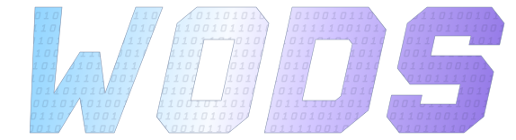
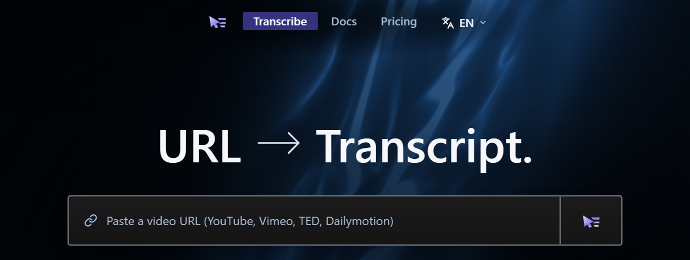

<picture>
  <source media="(prefers-color-scheme: dark)" srcset=".github/assets/wods-readme-wordmark-e8f773a0c216-dark.svg" />
  
</picture>

<h1>
  <picture>
    <source media="(prefers-color-scheme: dark)" srcset=".github/assets/wods-title-5f098c6a0c76-dark.svg" />
    
  </picture>
</h1>

Readable transcripts from supported video URLs.

[wods.io](https://wods.io) · [Documentation](https://wods.io/docs)

<h3>
  <picture>
    <source media="(prefers-color-scheme: dark)" srcset=".github/assets/wods-free-53f1c98d836c-dark.svg" />
    
  </picture>
</h3>

Unlimited free transcription from supported video URLs.

- **AI fallback** when captions are unavailable.
- **Read and search** segmented, timestamped transcripts.
- **Export** as JSON, TXT, SRT or VTT.

<h3>
  <picture>
    <source media="(prefers-color-scheme: dark)" srcset=".github/assets/wods-planned-55b3078ae1c7-dark.svg" />
    
  </picture>
</h3>

**Planned paid capabilities — not yet released.**

- **Volume:** 1,000,000 hours of video transcription and 50,000 hours of AI fallback transcription. Bulk and parallel processing for thousands of videos.
- **Sources:** Playlist, channel and website transcription, with channel auto-sync.
- **Workspace:** AI-edited transcripts and searchable transcript archives.
- **Integrations:** API access and key management, automations and completion webhooks, and MCP server integration.
